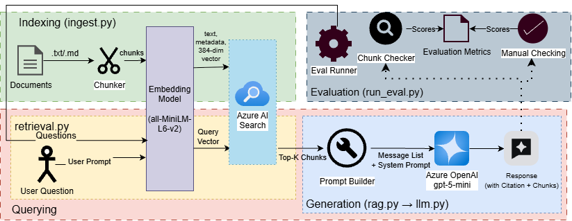

# Lore-Keeper: A RAG Pipeline for Long-Form Narrative Documents on Azure

A retrieval-augmented generation (RAG) system that answers questions over messy, human-written notes and cites the passages it used. The example corpus is a tabletop RPG campaign setting, which makes a good test case: lots of invented proper nouns, cross-references between documents, and answers that are easy for the author to verify.

**Status:** end-to-end pipeline working. Evaluation suite in progress.


## What it does

Ask a question about the notes and get an answer grounded in the source text, with chunk-level citations and the list of retrieved passages:

```
$ python -m scripts.ask "What does Agrash prioritize as a society?"

Agrash prioritizes honor, unity, and mutual service above material wealth. Its people value endurance, resilience, and camaraderie—survival and preserving their land
and way of life are central. Society is organized around living virtues (embodied by the Lash Ilneva), communal upbringing and trials that enforce tradition and duty,
and resolving disputes quickly so discord does not weaken the island’s honor. Children’s lives are guided by those shared traditions and devotion to Ilneva, even to the
point of sacrificial mercy when a life cannot bear the islands’ demands.
[lunaris-nation-agrash.md::0] [lunaris-nation-agrash.md::1] [lunaris-nation-agrash.md::4] [lunaris-nation-agrash.md::10] [lunaris-nation-agrash.md::11]

Retrieved:
  lunaris-nation-agrash.md::4 | Society and Governance (score 0.604)
  lunaris-nation-agrash.md::0 |  (score 0.583)
  lunaris-nation-agrash.md::10 | Agrashan Upbringing (score 0.547)
  lunaris-nation-agrash.md::11 | Agrashan Upbringing (score 0.478)
  lunaris-nation-agrash.md::1 |  (score 0.456)
  ...
```

If the notes don't contain the answer, the system is instructed to say so instead of guessing.

## Architecture

The system has two flows that meet at an Azure AI Search index.

**Indexing (`scripts/ingest.py`)**
1. Load `.md` / `.txt` notes
2. Clean markdown, split on headings, and pack whole sentences into chunks
3. Embed each chunk locally with `sentence-transformers/all-MiniLM-L6-v2` (384 dimensions)
4. Upload text, metadata, and vectors to an Azure AI Search index

**Querying (`src/retrieval.py` → `src/rag.py`)**
1. Embed the question with the same model
2. Run a hybrid (keyword + vector) query against Azure AI Search and take the top-k chunks
3. Build a prompt from a system instruction, the tagged chunks, and the question
4. Generate a cited answer with `gpt-5-mini` on Azure OpenAI

Retrieval and generation are separate stages so each can be tested on its own: bad answers can be traced to either "the right chunk wasn't retrieved" or "the model misused it."

## Design decisions

- **Sentence-aware chunking.** Fixed word windows cut sentences and proper nouns in half. Chunks are packed from whole sentences (~150 words, ~25 words of overlap) and fall back to hard splits only for oversized sentences.
- **Chunk size matches the embedding model.** `all-MiniLM-L6-v2` has a short input window, so larger chunks would be silently truncated. Chunk size and the embedding model are both config values, so they're easy to experiment with.
- **Local embeddings, Azure retrieval and generation.** Embedding a small corpus locally costs nothing and avoids needing a hosted embedding deployment. Search and generation run on Azure.
- **Hybrid search.** Invented names like "Ilneva" are exactly where keyword matching helps vector search. Mode is switchable (`SEARCH_MODE=hybrid|vector`).
- **Swappable components.** The LLM sits behind `src/llm.py` and retrieval behind `src/retrieval.py`. The chat model is referenced by deployment name from `.env`, so models can be swapped or replaced when retired without code changes. A local in-memory retriever is kept as a baseline and fallback (`RETRIEVER=local`).
- **Grounded prompting.** The system prompt restricts answers to the provided excerpts, requires `[chunk_id]` citations, and tells the model to say "I don't know" when the context doesn't contain the answer.
- **Index rebuilds from scratch.** `ingest.py` drops and recreates the index so it never holds stale chunks after changes to chunking, embeddings, or notes.

## Tech stack

Python · Azure AI Search (free tier) · Azure OpenAI / AI Foundry (`gpt-5-mini`) · sentence-transformers · python-dotenv

## Project structure

```
src/
  config.py         settings and env loading
  chunking.py       cleaning, heading split, sentence packing
  embeddings.py     sentence-transformers wrapper
  search_index.py   Azure AI Search create / upload / query
  retrieval.py      retrieve() with azure or local backend
  llm.py            chat model wrapper
  rag.py            prompt building and answer generation
scripts/
  ingest.py         chunk → embed → index
  ask.py            CLI for asking questions
data/sample/        example notes
docs/               architecture diagram
```

## Setup

**Prerequisites:** Python 3.12, an Azure subscription, an Azure OpenAI / Foundry chat model deployment, and an Azure AI Search service (free tier is enough).

```bash
git clone https://github.com/Echoed-Eco/narrative-rag.git
cd narrative-rag
python -m venv .venv
.venv\Scripts\activate        # macOS/Linux: source .venv/bin/activate
pip install -r requirements.txt
cp .env.example .env          # Windows: copy .env.example .env
```

Fill in `.env`:

```
AZURE_OPENAI_ENDPOINT=
AZURE_OPENAI_API_KEY=
CHAT_DEPLOYMENT=
SEARCH_ENDPOINT=
SEARCH_API_KEY= 
SEARCH_INDEX_NAME=
```

Build the index and ask a question:

```bash
python -m scripts.ingest
python -m scripts.ask "Tell me about <something in your notes>"
```

To use your own notes, replace the files in `data/sample/`, then rerun `ingest`.

## Evaluation (in progress)

A labeled question set will measure retrieval and answer quality separately:
- **Retrieval:** hit rate @ 5 against labeled source sections (automatic)
- **Answers:** correctness, graded by an LLM judge and validated against a hand-checked sample
- **Question types:** simple lookup, multi-section, cross-document, false-premise, and not-in-corpus